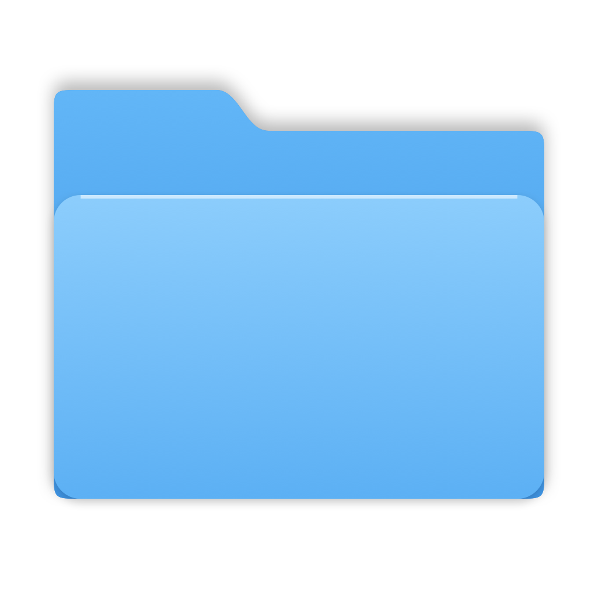

# Berkas Manager (aplikasi "Dokumen")

Brankas file terenkripsi untuk **macOS** dan **Windows**, dengan ikon yang menyamar sebagai **folder biasa**.
Simpan foto, video, dokumen, dan file teks penting; semuanya hanya bisa dibuka dengan password master.

**[Panduan instalasi & pemakaian lengkap](INSTALL.md)**  ·  **[Unduh](../../releases)**

## Fitur
- **Kamuflase:** aplikasi bernama "Dokumen" dengan ikon folder biru (macOS) atau kuning (Windows).
- Tambah file lewat tombol atau **seret & lepas**, termasuk seluruh isi folder.
- Opsi **hapus file asli** setelah berhasil diamankan.
- **Pratinjau gambar** (galeri dengan panah kiri/kanan) dan **file teks** langsung di aplikasi.
- Video & file lain dibuka dengan aplikasi bawaan lewat salinan sementara yang **dihapus otomatis** saat dikunci/ditutup.
- Keluarkan satu file atau **semua file** kembali ke folder biasa.
- Cari, saring (Gambar/Video/Dokumen), ganti nama, hapus.
- Terkunci otomatis setelah 5 menit tidak ada aktivitas.

## Keamanan
- Password master → **Argon2id** (64 MiB, 3 iterasi) → kunci indeks.
- Setiap file memakai **kunci acak sendiri**, dienkripsi **XChaCha20-Poly1305** secara bertahap per 1 MiB
  (konstruksi STREAM), sehingga video berukuran GB pun tidak membebani memori.
- **Nama file juga dienkripsi.** Di disk hanya ada `index.vault` dan file `blobs/<acak>.bin`.
- Potongan file yang diubah, dipotong, ditukar, atau dipindah ke file lain **terdeteksi dan ditolak**.
- Ganti password hanya mengenkripsi ulang indeks, file besar tidak perlu diproses ulang.
- **Password tidak bisa dipulihkan.** Lupa = file tidak bisa dibuka oleh siapa pun.

## Pengembangan
    npm install
    npx tauri dev
    cargo test --lib --manifest-path src-tauri/Cargo.toml
    npx tauri build
